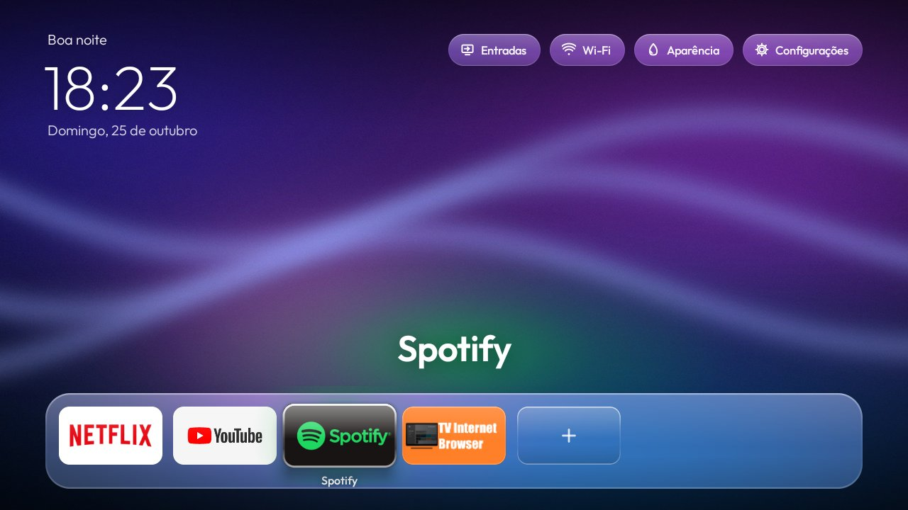
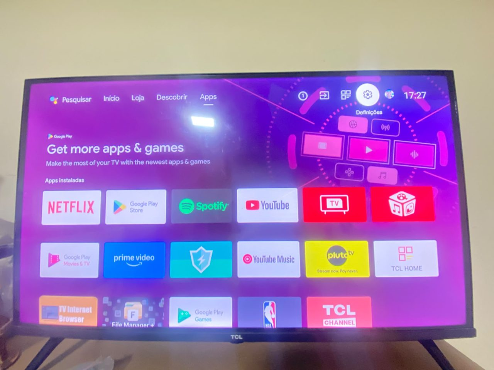
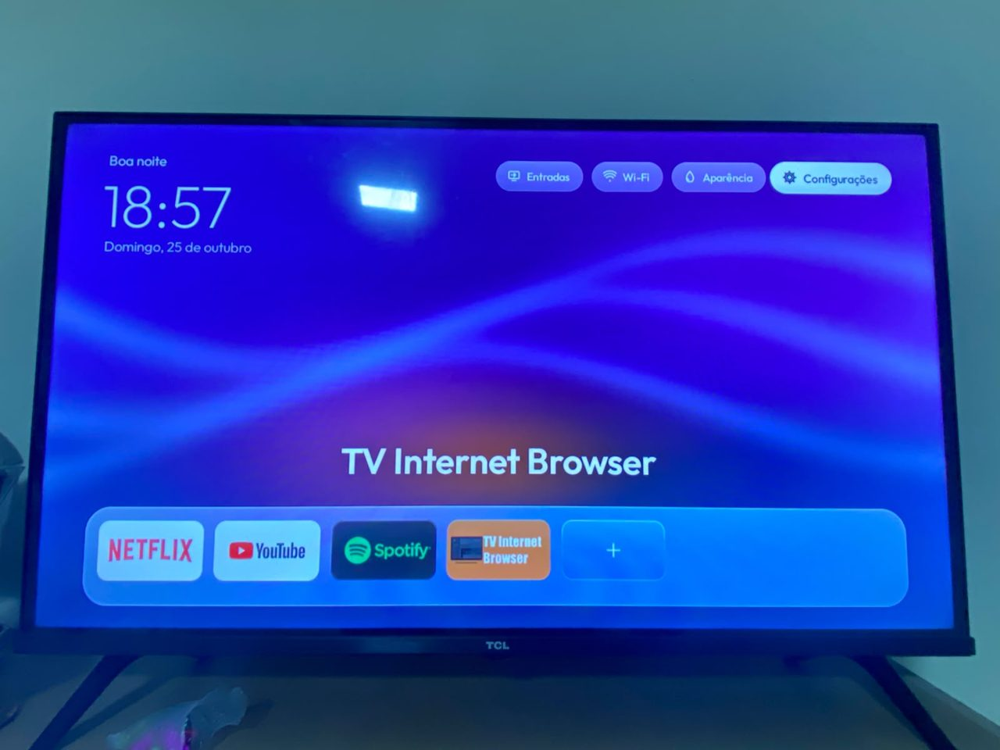
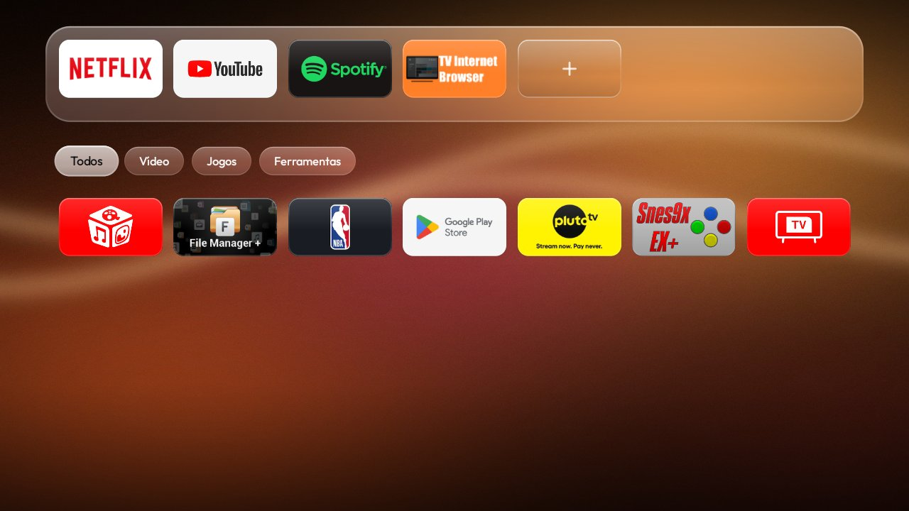
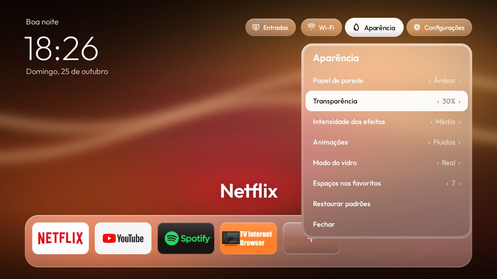
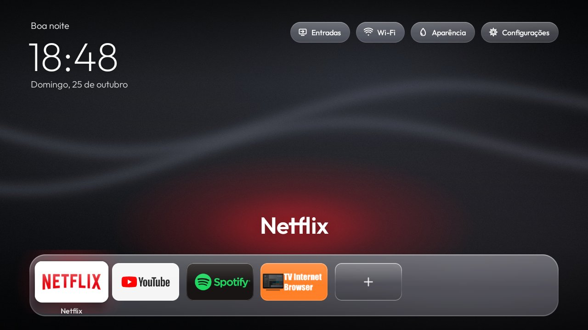
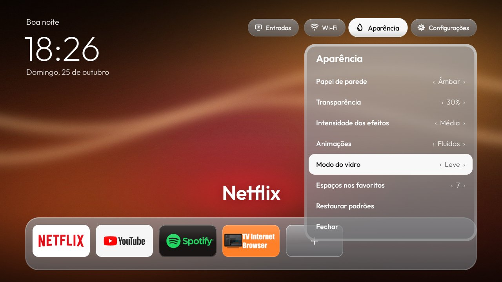

# Vidro — launcher "vidro líquido" para Android TV



**Vidro** é uma tela inicial para Android TV com acabamento de vidro líquido: painéis foscos, reflexos, bordas iluminadas, profundidade e animações com mola. A Apple foi só referência estética; a identidade visual é própria, e o código, os ícones e os papéis de parede foram feitos do zero.

O repositório traz também um **kit em Python** para fazer backup, limpar apps de fábrica, instalar e restaurar uma Android TV pela rede. Ele usa ADB em Python puro, sem precisar instalar o Android SDK.

> Testado numa **Semp TCL 32S615** (Android TV 9 / API 28, ARM 32 bits, 1280×720). Funciona em Android TV 7 ou mais novo.

## Antes e depois (fotos da TV real)

| Antes: launcher de fábrica, cheio de apps e anúncios | Depois: Vidro |
|---|---|
|  |  |

## Botão Globoplay → YouTube em ação


No vídeo, o botão **globoplay** do controle abre o **YouTube** e o botão **NETFLIX** continua abrindo o Netflix, sempre voltando ao Vidro.
Vídeo completo: [docs/video/botao-globoplay-youtube.mp4](docs/video/botao-globoplay-youtube.mp4) · Como fazer: [docs/BOTAO-GLOBOPLAY-YOUTUBE.md](docs/BOTAO-GLOBOPLAY-YOUTUBE.md)

## Capturas da interface

| | |
|---|---|
|  |  |
| Categorias e grade | Menu **Aparência** (ao vivo) |
|  |  |
| Papel de parede Grafite | Modo **vidro leve** (sem desfoque) |

## Recursos

- **Vidro fosco de verdade no Android 9.** O sistema não tem *blur* em tempo real (só existe a partir do Android 12). Por isso o papel de parede é desfocado uma vez e cada painel desenha o trecho que fica atrás dele. Veja [ARQUITETURA](docs/ARQUITETURA.md).
- **Menu Aparência:**
  - papel de parede: 4 originais, Preto ou uma imagem sua;
  - transparência;
  - intensidade dos efeitos;
  - animações: fluidas, reduzidas ou desligadas;
  - modo do vidro: Real ou Leve;
  - quantidade de favoritos: de 4 a 7.
- **Favoritos:** segure OK sobre um app para fixar, mover, remover ou ocultar.
- **Categorias:** Vídeo, Música, Jogos e Ferramentas, tiradas de `ApplicationInfo.category`.
- **Navegação pelo D-pad:** uma linha por toque, sem saltos, e lembra o último app selecionado.
- **Entradas:** HDMI, AV e TV ao vivo, pela TV Input Framework.
- **Leve:** cerca de 35 MB de RAM, mediana de 14 ms por quadro na TV de teste, sem vídeo e sem rede.
- **Botão Globoplay do controle abre o YouTube** (controles TCL). O firmware só sabe abrir o Globoplay, então um app mínimo e invisível ocupa esse lugar e abre o YouTube. O botão Netflix continua igual, e tudo é reversível. Veja **[docs/BOTAO-GLOBOPLAY-YOUTUBE.md](docs/BOTAO-GLOBOPLAY-YOUTUBE.md)**.

## Comece aqui

| Quero… | Guia |
|---|---|
| Instalar na minha TV, do zero, com backup e limpeza | **[docs/PASSO-A-PASSO.md](docs/PASSO-A-PASSO.md)** |
| Trocar o botão **Globoplay → YouTube** do controle | **[docs/BOTAO-GLOBOPLAY-YOUTUBE.md](docs/BOTAO-GLOBOPLAY-YOUTUBE.md)** |
| Publicar este projeto no GitHub | [docs/PUBLICAR-GITHUB.md](docs/PUBLICAR-GITHUB.md) |
| Rodar no Replit (compila e serve o APK) | [docs/PUBLICAR-REPLIT.md](docs/PUBLICAR-REPLIT.md) |
| Entender como funciona | [docs/ARQUITETURA.md](docs/ARQUITETURA.md) |
| Resolver problemas (porta 5555, push travando…) | [docs/SOLUCAO-DE-PROBLEMAS.md](docs/SOLUCAO-DE-PROBLEMAS.md) |

### Resumo em 6 comandos (PC com Python 3.8+ e JDK 11+)

```bash
python -m pip install -r requirements.txt
python build/fetch_toolchain.py             # baixa aapt2 + android.jar do Google (uma vez)
python build/build.py                       # gera dist/Vidro.apk
python tools/backup.py   --host 192.168.0.50
python tools/install.py  --host 192.168.0.50                    # instala (abre como app)
python tools/install.py  --host 192.168.0.50 --set-home         # vira a tela inicial
```

Botão Globoplay → YouTube (controles TCL), em dois comandos:

```bash
python build/build.py atalho-globoplay
python tools/install.py --host 192.168.0.50 --atalho-globoplay
```

Para desfazer tudo: `python tools/restore.py --host 192.168.0.50`.

## Estrutura

```
app/                  código do launcher (Java, sem Gradle; API 24–28)
  src/com/breno/tvhome/  HomeActivity, Frost (vidro), Backdrop (desfoque), Look (ajustes)…
  assets/             fonte Outfit (OFL) e papéis de parede originais
atalho-globoplay/     opcional: botão "Globoplay" do controle TCL abre o YouTube
build/                build.py (aapt2 → javac → dx → assinatura) e fetch_toolchain.py
tools/                ADB em Python: discover, backup, debloat, install, restore, tv, adb_closed, relay
config/               lista de limpeza em lotes (TCL Android 9) — revise para a sua TV
web/                  página do projeto para o Replit (compila e serve o APK)
docs/                 guias e capturas
.github/workflows/    CI: compila o APK a cada push e publica Release em tags v*
```

## Segurança

- **Nada é desinstalado:** a limpeza usa `pm disable-user`, e `tools/restore.py` reativa tudo.
- **Pacotes protegidos:** o `debloat.py` recusa pacotes essenciais e qualquer pacote de fábrica (*factory*).
- **Feche o ADB ao terminar.** A porta 5555 é texto puro. Desligue a *Depuração USB*, revogue as autorizações e confira com `tools/adb_closed.py`.
- **Não publique:** `tools/.adbkey`, `build/keystore/`, `backups/`. O `.gitignore` já cuida disso.

## Licença

Código sob [MIT](LICENSE). Fonte Outfit sob SIL OFL 1.1. Detalhes de terceiros e marcas em [NOTICE.md](NOTICE.md).
Projeto pessoal, **sem afiliação** com Apple, Google, TCL, Netflix ou Globo.
