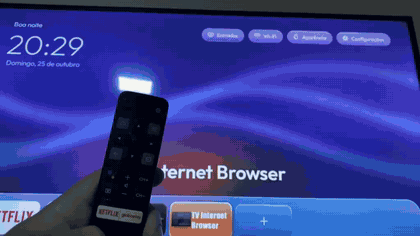

# Botão "Globoplay" do controle → YouTube

Os controles Bluetooth das TVs Semp TCL com Android TV têm dois botões de app: **NETFLIX** e **globoplay**.
Aqui o botão Globoplay passa a abrir o **YouTube**, em qualquer tela. O botão Netflix continua igual.

## Resultado

| Botão | Antes | Depois |
|---|---|---|
| NETFLIX | abre o Netflix | abre o Netflix (sem mudança) |
| globoplay | abria a página do Globoplay na Play Store (o app não estava instalado) | **abre o YouTube** |



Vídeo na TV real (19 s): [video/botao-globoplay-youtube.mp4](video/botao-globoplay-youtube.mp4)

## Como instalar

Precisa da TV com a *Depuração USB* ligada (veja o [PASSO-A-PASSO](PASSO-A-PASSO.md)).

```bash
python build/build.py atalho-globoplay                         # gera dist/Atalho-Globoplay.apk
python tools/install.py --host 192.168.0.50 --atalho-globoplay  # instala na TV
```

Para testar, aperte o botão **globoplay** no controle: o YouTube deve abrir. O atalho não aparece na lista de apps do Vidro.

## Como desfazer

```bash
python tools/tv.py --host 192.168.0.50 --shell "pm uninstall com.globo.globotv"
```

O `tools/restore.py` também remove o atalho. Ele só desinstala se for o nosso atalho, identificado pelo `versionName` que contém "atalho", e nunca remove o Globoplay real.

> **Quer instalar o Globoplay de verdade?** Remova o atalho antes. Ele ocupa o identificador `com.globo.globotv`, então a Play Store não instala o app real enquanto o atalho existir.

## Como foi descoberto (passo a passo da investigação)

1. **Log das teclas.** Com o `logcat` limpo, apertamos os botões no controle e lemos o log:
   ```
   python tools/tv.py --shell "logcat -c"
   (aperte o botão no controle)
   python tools/tv.py --shell "logcat -d | grep -E 'interceptKeyTq keycode|START u0'"
   ```
   - NETFLIX envia o **keycode 4062**. O sistema manda o broadcast `com.netflix.ninja.intent.action.NETFLIX_KEY`, e o Netflix abre.
   - globoplay envia o **keycode 4097**. Em seguida, um processo do sistema (uid 1000) abre a Play Store em `details?id=com.globo.globotv`.

2. **Primeira tentativa: serviço de acessibilidade. Não funcionou.** O Android permite filtrar teclas com `AccessibilityService` (`flagRequestFilterKeyEvents`). Só que o log mostrou `policyFlags=2b000000` nessas teclas:
   - bit `0x01000000` = **INJECTED**: o serviço Bluetooth do controle TCL *injeta* o keycode;
   - o bit `FILTERED` não aparece, ou seja, o evento **não passa pelo filtro de acessibilidade**.

   Resultado: a acessibilidade nunca vê as teclas 4097 e 4062. Essa abordagem foi descartada.

3. **Quem trata o 4097.** Uma busca somente leitura pelo texto `globotv` nos APKs do sistema apontou o `com.tcl.keycustomfunctionservice` (KeyCustomFunctionService.apk). Na análise estática (androguard, **sem executar nada**), o método `processShortCutKey` faz o seguinte:
   ```java
   // keycode 4097 ("GloboPlay")
   String act = getActivityNameFromPackage(ctx, "com.globo.globotv"); // procura MAIN + LEANBACK_LAUNCHER (ou LAUNCHER)
   if (act == null)  abrir "https://play.google.com/store/apps/details?id=com.globo.globotv";
   else              startActivity(new ComponentName("com.globo.globotv", act));
   ```
   O nome do pacote está **fixo no firmware**. Não existe configuração (settings, arquivo ou provider) para trocar.

4. **Solução.** Instalar um app mínimo com o pacote `com.globo.globotv`. Ele tem uma única activity `LEANBACK_LAUNCHER`, com tema `Theme.NoDisplay`, que abre o YouTube e fecha na hora (`atalho-globoplay/src/com/globo/globotv/OpenYouTube.java`). O firmware encontra essa activity e a abre. O Vidro esconde esse app da lista por causa da `meta-data com.breno.tvhome.HIDE`.

## Trocar o destino (outro app em vez do YouTube)

Em `atalho-globoplay/src/com/globo/globotv/OpenYouTube.java`, troque o pacote:

```java
String pkg = "com.google.android.youtube.tv";   // ex.: "com.spotify.tv.android"
```

Depois compile e instale de novo:

```bash
python build/build.py atalho-globoplay
python tools/install.py --host 192.168.0.50 --atalho-globoplay
```

## Outros botões

O mesmo serviço da TCL trata outros keycodes de app. Encontramos estes no firmware V8-R41KT01:

| keycode | Destino no firmware | Pode usar o mesmo truque? |
|---|---|---|
| 4097 | `com.globo.globotv` | **sim** (este guia) |
| 4062 | Netflix (broadcast `NETFLIX_KEY`) | não é necessário |
| 4082 | `com.google.android.tvlauncher/.appsview.AppsViewActivity` | não, porque usa um componente fixo |
| 4077 | botão Entradas/Fonte (janela de fontes da TCL) | não mexer |

## Avisos

- O atalho é para **uso pessoal** na sua própria TV. **Não publique** esse APK em lojas nem o distribua como se fosse o app da Globo. Por isso ele também fica fora das Releases do GitHub.
- A Play Store pode listar "Globoplay" como instalado e falhar ao tentar atualizar, porque a assinatura é diferente. Isso é esperado.
- Atualizações de firmware da TCL podem mudar esse comportamento.
